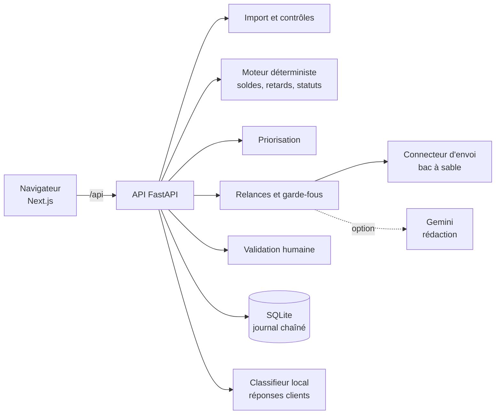

# Recouvra : rapport de projet

Hackathon BWAI, cas pratique 1 « Recouvrement des factures impayées ». Prototype local, données fictives,
licence MIT.

## 1. Besoin et utilisateur cible

**Utilisateur** : le gestionnaire du poste clients d'une PME béninoise (ici, une société de distribution fictive à
Cotonou), qui suit quelques centaines de factures et relance ses clients par SMS, WhatsApp ou e-mail. Ses clients
paient surtout par mobile money (MTN MoMo, Moov Money, Celtiis Cash).

**Problème constaté** : la relance est faite à la main, parfois trop tard, sans priorité, et il arrive de relancer
une facture déjà réglée parce que le paiement mobile money n'a pas encore été reporté. Chaque erreur abîme la
relation client.

**Objectif** : envoyer la bonne relance au bon moment, sans jamais relancer une facture payée, sans jamais faire
deux fois la même action, en laissant les décisions sensibles (litiges, gros montants) à un humain, et en
pouvant expliquer chaque décision après coup.

## 2. La solution en bref

1. **Importer** des fichiers CSV ou Excel tels qu'ils sortent des logiciels (encodages, séparateurs et noms de
   colonnes variés), avec contrôle de chaque ligne, détection des doublons et rapport d'import.
2. **Calculer** soldes, retards et statuts avec un moteur déterministe ; **rapprocher** les paiements mobile money
   grâce à une référence courte à chiffre de contrôle citée par le client.
3. **Prioriser** avec un score transparent (ancienneté, solde, historique), chaque rang étant expliqué en une phrase.
4. **Relancer** selon une séquence graduée (R1 à R5), un seul message par client et par jour, avec un ton
   courtois au vouvoiement et une légère touche béninoise.
5. **Maîtriser** : validation humaine des cas sensibles, revérification juste avant l'envoi, reprise sans doublon
   après une coupure, journal d'audit infalsifiable, arrêt d'urgence.
6. **IA encadrée** (désactivable) : rédaction des messages par Gemini sous contrôle strict, classification locale
   des réponses clients confirmée par un humain.

## 3. Architecture

| Couche | Choix | Raison |
|---|---|---|
| Cœur | Python 3.10, FastAPI | Rapide à écrire, lisible, testable |
| Données | SQLite (un fichier, transactions, déclencheurs) | Local, réinitialisable, sans serveur |
| Montants | Entiers en unités mineures + `Decimal` | Aucun flottant pour l'argent |
| Interface | Next.js, TypeScript, Tailwind, polices embarquées | Fonctionne hors ligne ; ne calcule rien |
| Tests | pytest, hypothesis (tests par propriétés) | 305 tests, couverture 90 % |
| IA | Gemini `gemini-3.5-flash` (rédaction), bayésien naïf local (classification) | Remplaçable, désactivable |

L'interface n'effectue aucun calcul : montants affichés, points du score et statuts viennent de l'API. Chaque
action envoie une clé d'idempotence : un double clic rejoue la même réponse sans refaire l'action.

## 4. Règles métier

Toutes les règles sont écrites dans `docs/regles_metier.md` et testées.

- **Statuts**, dans l'ordre de priorité : clôturée, en litige, suspendue, payée (solde nul), partiellement payée,
  échue (retard d'au moins un jour), à échoir. Une seule fonction change le statut enregistré : elle vérifie la
  table des transitions, incrémente la version de la facture et journalise la règle. Le système ne peut ni sortir
  seul d'un litige, ni rouvrir une facture payée.
- **Rapprochement** : seul un paiement citant une référence valide, connue, sur une facture ouverte de même devise
  est appliqué automatiquement. Une référence mal saisie, inconnue, ambiguë ou visant une facture déjà soldée part
  en validation, avec une proposition quand elle est sûre.
- **Priorisation** : score sur 100 = 0,5 × ancienneté + 0,3 × solde + 0,2 × historique de retard (poids réglables
  par le validateur, simulables avant enregistrement). Les gros montants passent en tête car ils vont à l'humain.
  Départage stable par numéro de facture. Aucune prédiction de non-paiement.
- **Séquence** : R1 dès 1 jour de retard, R2 dès 10 jours, R3 dès 30 jours (validation), R4 dès 45 jours
  (validation, proposition d'échéancier), R5 dès 90 jours (dossier remis au responsable, aucun message client).
  Délai minimal de 7 jours entre deux relances d'une même facture.

## 5. Garde-fous

| Exigence | Mise en œuvre | Preuve |
|---|---|---|
| Calculs déterministes | Fonctions pures, une seule fonction d'arrondi | Oracle indépendant : 115 factures et 34 paiements conformes à 100 % |
| Humain dans la boucle | Litiges, gros montants (dès 1 000 000 FCFA), clients sensibles, R3 à R5, messages IA | File de validation : approuver, modifier (revérifié), rejeter, suspendre ; validation groupée des cas ordinaires |
| Idempotence | Clé unique `facture, étape, échéance` en base ; un message par client et par jour | Préparation et envoi relancés : rien ne se duplique |
| Reprise | Verrou d'envoi, accusé du connecteur par clé d'envoi, reprise au redémarrage | Un vrai processus tué à 3 instants : aucun doublon, y compris « tué après l'envoi, avant l'enregistrement » |
| Revalidation | État réel relu juste avant l'envoi (version, solde, statut, paiement en attente, promesse) | Un paiement arrivé entre validation et envoi annule le message |
| Traçabilité | Journal en ajout seul, déclencheurs SQL, chaînage SHA-256 | Le journal copié seul dans une base vide explique le sort de chaque relance |

## 6. IA encadrée

Résumé de la fiche IA (`docs/fiche_ia.md`) :

- **Rédaction** : le modèle ne reçoit ni nom, ni montant, ni numéro ; il écrit avec des marqueurs que le code
  remplace. Un seul chiffre écrit par le modèle, un marqueur manquant ou un mot interdit, et le gabarit fixe est
  conservé. Résultat réel : 6 messages sur 6 acceptés, 11,6 s par appel en moyenne. Tout message IA est validé
  par un humain.
- **Classification des réponses** : modèle local, hors ligne. 85 % d'exactitude sur 48 messages jamais vus,
  **100 % des litiges signalés**. Toute proposition attend la confirmation d'un humain.

## 7. Tests et résultats chiffrés

**Pyramide de tests** (305 tests, `python tasks.py test`) : unitaires (calculs, références, gabarits, dates),
intégration (import vers base, relance vers journal), bout en bout (parcours API complet), robustesse (coupure
réelle, double clic, envois concurrents, fichier corrompu, panne du fournisseur), sécurité (rôles, sessions,
masquage, injection), IA (évaluation, repli sans IA). Tests par propriétés sur le solde, le score et les
références.

**Jeu de test piégé** : 138 lignes de factures et 35 paiements générés avec une graine fixe : doublons exacts,
conflits de numéro, quasi-doublons, 13 lignes invalides, fichier Windows-1252 à virgule, paiements partiels,
trop-perçu, litiges, références mal saisies ou absentes, dates de fin d'année. Chaque ligne a son résultat attendu.

**Charge** (`python -m app.charge`) : 10 000 factures, 500 clients, 3 424 paiements traités en **8,5 secondes**
(import 2,2 s, rapprochement 1,9 s, file du jour 0,7 s, préparation de 6 280 relances 3,1 s ; base de 33 Mo). Le
premier essai prenait 326 s à l'import : les contrôles de doublons ont été regroupés par client.

**Gains face à une référence** (`docs/mesure_gains.md`). Référence : relance naïve de chaque ligne échue du fichier,
dans l'ordre, un message par facture, avec un suivi des paiements mis à jour chaque semaine.

| Mesure | Référence naïve | Recouvra |
|---|---|---|
| Factures payées ou paiements récents relancés | 3 | 0 |
| Doublons relancés | 2 | 0 |
| Litiges relancés | 3 | 0 |
| Lignes invalides relancées | 11 | 0 |
| Anomalies du fichier signalées | 0 sur 19 | 19 |
| Messages envoyés | 90 | 24 |
| Solde dû traité dans la première heure | 8,7 M FCFA | 31,6 M FCFA |
| Temps de traitement (hypothèses) | 270 min | 13 min |

Les erreurs sont mesurées sur les données ; les temps humains sont des hypothèses (3 min par relance manuelle,
30 s par message à valider) à remplacer par le chronométrage décrit dans `docs/protocole_mesure.md`.

## 8. Sécurité

- Sessions par jeton (mot de passe haché PBKDF2, jeton stocké sous forme d'empreinte, durée 8 h) ; trois rôles :
  gestionnaire, validateur, auditeur (lecture seule, téléphones masqués).
- Aucun secret dans le dépôt : la clé d'IA est dans `.env`, exclu par `.gitignore`, vérifié avant chaque commit.
- Entrées validées partout ; erreurs lisibles, jamais de trace technique ; taille d'import limitée à 20 Mo.
- Le texte d'un client n'est jamais traité comme une instruction ; aucune donnée personnelle n'est envoyée au
  modèle distant ; journal des appels IA.
- Sauvegarde cohérente et restauration vérifiée (intégrité et journal) en une commande.

## 9. Limites, risques et coûts

**Limites connues**
- Envoi simulé (bac à sable) : brancher un vrai fournisseur SMS ou WhatsApp demande d'écrire un connecteur.
- Base SQLite non chiffrée : protéger le poste (chiffrement du disque).
- Jours fériés béninois et quelques règles marqués « à valider » avec un professionnel.
- Classifieur faible sur les messages très courts ou hors sujet (« ok », « bonsoir ») ; sans conséquence car un
  humain confirme toujours.
- Temps de gain estimés et non chronométrés.

**Coûts**
- Fonctionnement : un poste de travail, aucun serveur ; base de 33 Mo pour 10 000 factures.
- IA : classification gratuite (locale) ; rédaction dans le quota gratuit de Google AI Studio pour le prototype,
  environ un appel par client relancé et par jour en production.
- Maintenance : règles et seuils dans les paramètres (sans code), migrations versionnées, 305 tests de non-régression.

**Pistes** : connecteurs réels (WhatsApp Business, passerelle SMS), import direct des relevés des opérateurs,
échéanciers suivis dans l'outil, tableau de bord par commercial, chiffrement de la base.
